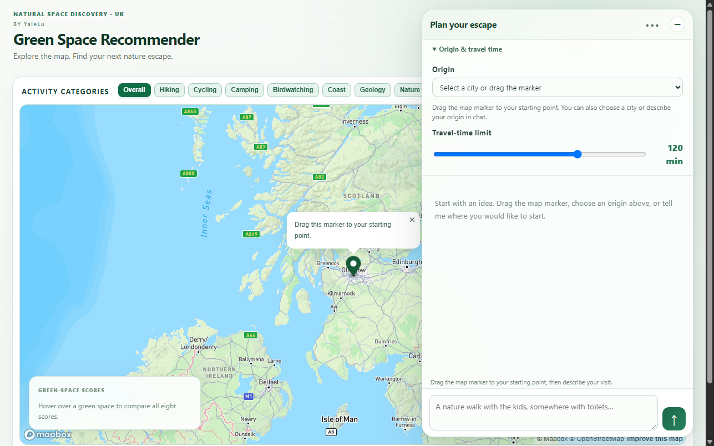

# Green-space recommendation demo

## 🌿 [Open the live website](https://green-space-ai.onrender.com/)

**Live demo:** https://green-space-ai.onrender.com/



Local UK green-space explorer with a map and persistent multi-turn conversation.
Core dialogue fixes: 2026-10-23; targeted live-model verification: 2026-10-24.

## Run

Requires Python 3.9+ and Node.js 18+ (built-in modules only). The browser loads Mapbox GL from its CDN.

1. Copy `.env.example` to `.env` in this folder and supply your own provider credentials.
2. Run `python recommendation_web_demo.py --port 8766` from this folder.
3. Open http://127.0.0.1:8766/.

Configure Google Maps/Places, Groq, TravelTime and a Mapbox public browser token. API requests may incur charges. Never commit `.env`. Restrict the public Mapbox token to the intended app URLs.

## Current behavior

- In **Pollok Park 3D**, select **Show station walk** to see the shortest walk from the mapped Pollokshaws West station exit to one of two curated access points. **Simulate south access closure** removes that access node from the graph and recalculates the route. The result is an OSM snapshot estimate, with walking time based on 80 m/min. This is a separate sample from the national recommendation ranking.
- To regenerate the route data, download the [original OSM map extract](https://api.openstreetmap.org/api/0.6/map?bbox=-4.322,55.821,-4.298,55.832) and run `python pollok_routes.py pollok.osm`. The Python service calculates shortest paths and returns GeoJSON at `/api/pollok-route` and `/api/pollok-route?closed=1`. The [Burrell visitor guide](https://burrellcollection.com/visit/plan-your-visit/) identifies the main entrance and station approach. The [Glasgow planning report](https://onlineservices.glasgow.gov.uk/CouncillorsandCommittees/viewSelectedDocument.asp?c=P62AFQDNNT81UT812U) documents the southern core path. Coordinates use mapped nodes and access changes in the demo are simulated.

- **Pollok Park 3D** opens the Glasgow sample in a separate map with independently toggleable buildings, roads, paths and water. Features are from the [OpenStreetMap map API](https://api.openstreetmap.org/api/0.6/map?bbox=-4.322,55.821,-4.298,55.832) (ODbL), converted with `python prepare_pollok.py pollok.osm`. Mapbox GL JS uses the existing public token, satellite basemap and Mapzen elevation. The building layer extrudes mapped footprints using tagged heights, estimates from mapped floors or a labelled 5 m default. The Burrell Collection uses a CityJSON LoD2 roof mesh from the [Glasgow LiDAR archive](https://zenodo.org/records/15000747) (Li et al., CC BY 4.0, model NS56SE_3626). The Three.js custom layer replaces its OSM extrusion. The preparation script reads downloaded ZIP byte ranges and uses pyproj to match British National Grid footprints and convert vertices to WGS84. Pollok House still uses the OSM extrusion.

- **Richmond Park 3D** opens a local interactive 400 × 400 m sample with surface and bare-ground views. It uses Environment Agency 2022 LiDAR Composite 1 m DTM and last-return DSM (Open Government Licence v3). The matching WCS GetCoverage subsets are EPSG:27700 `E(519450,519850)` and `N(172600,173000)`, with output format `image/tiff`. Coverage IDs are `13787b9a-26a4-4775-8523-806d13af58fc__Lidar_Composite_Elevation_DTM_1m` and `9ba4d5ac-d596-445a-9056-dae3ddec0178__Lidar_Composite_Elevation_LZ_DSM_1m`. Defra's endpoint is `https://environment.data.gov.uk/geoservices/datasets/{dataset-id}/wcs`. Run `python prepare_richmond_elevation.py ground.tif surface.tif` with NumPy and Pillow to regenerate the bundled binary. The browser renders the 1 m grids with the bundled Three.js and WebGL, and colours the surface by its height above the DTM. This view requires no external map token or network requests.

- Choose an origin city, drag a map point, or describe a supported city in chat. Set a travel limit and activities. There is no departure-date or transport selector.
- Access to an origin station uses public transport or a taxi proxy, followed by train and walking. The three nearest dataset stations are considered without a 2 km origin cutoff. Taxi waiting is not modelled.
- Destination candidates need a station within 2 km of the green-space boundary, measured straight-line, not along a walking route. Only explicitly disallowed access is excluded.
- Preserve eligible, recently verified previous recommendations, then check more ranked candidates until five matches, candidate exhaustion, or 20 new facility checks. Facility cache reuse is limited to six hours and must cover the current needs.
- Required facilities need affirmative evidence; unknown does not mean absent and does not satisfy a requirement.
- Follow-up questions reuse the last explained place and available Google review summaries. Quiet atmosphere and fewer crowds are evaluated separately. Subjective evidence explanations do not rerank recommendations.
- Cancelling a playground requirement cannot implicitly remove family-friendly preferences or accompanying children. Explicit cancellations affect their own fields.
- The map, scores and expandable recommendations are displayed alongside the conversation.

## Implementation

`dialogue_llm.mjs` extracts structured intent through Groq; `dialogue_service.py` validates and merges state and stores sessions locally. `dialogue_policies.py` protects follow-up updates and resolves places. `review_followup.py` validates source quotations. `facility_search.py` manages bounded facility checks and reuse. `station_filter.py`, `train_access.mjs` and `traveltime_train.mjs` handle spatial and travel constraints. `recommendation_fit.py` and `recommendation_explanations.py` explain indicator and facility evidence.

The bundled `natural_assets_2.geojson` supplies project green-space geometry and scores. `railway_stations.geojson` derives from the parent project's `src/505network_nodes.geojson`; station freshness and operational status are inherited. Data provenance and reuse permissions must be checked before redistribution outside the original project context.

## Local tests

```powershell
python -m unittest test_followup_fixes test_facility_search test_reachability_prefilter test_geospatial_match test_recommendation_evidence test_dialogue_service test_station_filter -q
node --test test_train_access.mjs
```

The Python suite covers 68 checks without live provider calls. Historical transcripts, screenshots, reports, generated outputs, local sessions and credentials are not part of this code submission.

## Limits

This is a local demo, not a production service. Chat processing is serialized. Reference departure time is generated by the backend; estimates do not represent a booked itinerary. Train-mode isochrones can include walking-only journeys; actual boarding and usable park entrances are not individually verified. Reviews are historical opinions, not real-time crowd measurements or guarantees. Unchecked candidates may still qualify. A dedicated next-page / different-candidates workflow is not implemented.

The optional local report URL returns 404 when report artifacts are absent; reports are intentionally excluded from the project-only submission. Local conversations are saved to `dialogue_sessions.sqlite3`; do not publish them.
